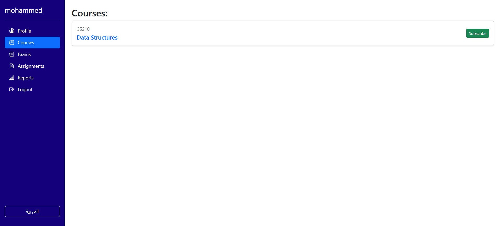
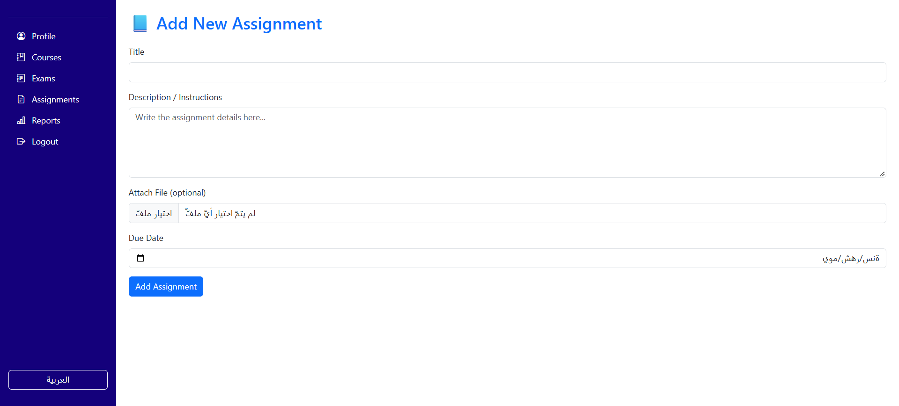
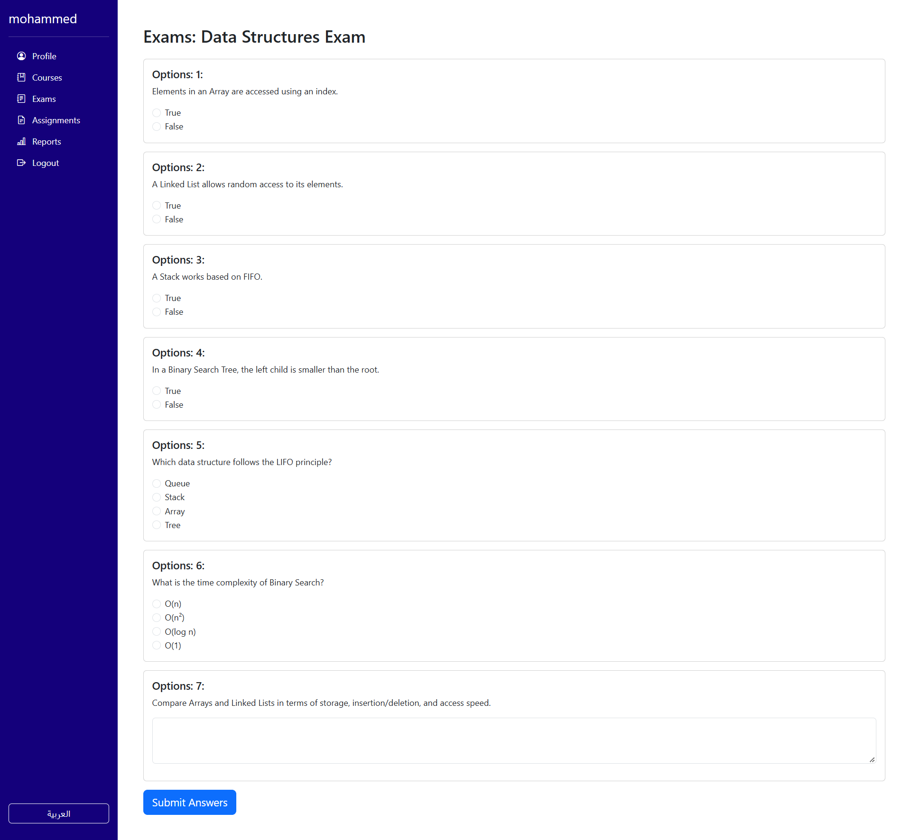
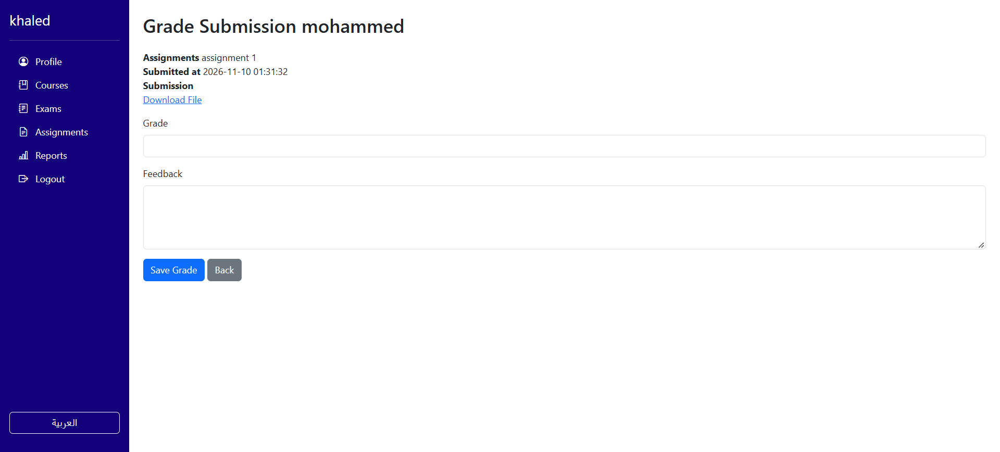

# Learning Management System (LMS)

A role-based web application where **instructors** create courses, assignments and exams, and **students** enroll, submit their work and see their grades. The interface is bilingual (English and Arabic).

Built with **PHP (mysqli), MySQL, HTML, CSS, Bootstrap and JavaScript**.

## Features

**Instructors**
- Create, edit and delete their own courses (with an optional attached file)
- Add, edit and delete assignments with a due date and a file
- Create and edit exams with questions and a start and end time
- View the submissions for each assignment, then grade them and write feedback
- Reports page with an overview of their courses

**Students**
- Register, log in and change their password
- Browse courses, subscribe and unsubscribe
- Submit assignments with a file upload
- Take exams inside the allowed time window (one attempt per exam) and see their result
- See their grades and feedback

**General**
- Separate accounts and permissions for instructors and students
- Arabic and English interface with a language switch
- Client-side form validation

## Screenshots

### Courses
Students browse the available courses and subscribe or unsubscribe. Instructors see their own courses and can add, edit or delete them.

### Assignments
Instructors create assignments with a due date and a file, and open the submissions to grade them. Students open an assignment and upload their work.

### Taking an exam
Students answer the questions inside the time window set by the instructor. Each student has one attempt, and sees the result after submitting.

### Grading a submission
Instructors give a grade and write feedback for each submission.

## Security

- All queries that use user input use **prepared statements** (protection against SQL injection)
- Passwords are stored with `password_hash` and checked with `password_verify`
- `session_regenerate_id` on login (protection against session fixation)
- **Access control on every action.** Instructors can edit or delete only their own courses, assignments and exams, and can grade only submissions of their own assignments. Students can only take exams and subscribe to courses with a student account, and can only see their own results.
- **Safe file uploads:** file type whitelist, a 5 MB size limit, random file names, and a `.htaccess` in `uploads/` that stops PHP files from running
- Output is escaped with `htmlspecialchars`

## Run it locally (XAMPP)

1. Install [XAMPP](https://www.apachefriends.org/) and start **Apache** and **MySQL**.
2. Copy this project folder into `C:\xampp\htdocs\` (for example `C:\xampp\htdocs\LMS`).
3. Open phpMyAdmin (`http://localhost/phpmyadmin`), create a database named **`lms_db`**, choose it, then use **Import** with the file `lms_db.sql`.
4. Check the connection settings in `config/database.php`. A default XAMPP uses user `root` and an empty password.
5. Open `http://localhost/LMS/`, register an instructor account and a student account, and try the two roles.

The `uploads/` folder is kept empty in Git (only its `.htaccess` is stored). The `assignments`, `courses` and `submissions` folders are created automatically on the first upload.

## Project structure

| Path | Purpose |
| --- | --- |
| `index.php`, `register.php`, `logout.php` | Login, registration and logout |
| `courses.php`, `addCourse.php`, `viewCourse.php` | Courses |
| `assignments.php`, `addAssignment.php`, `editAssignment.php`, `submitAssignment.php`, `viewSubmissions.php`, `gradeSubmission.php` | Assignments and grading |
| `exams.php`, `addExam.php`, `editExam.php`, `takeExam.php`, `examResult.php` | Exams |
| `profile.php`, `change_password.php`, `reports.php` | Profile and reports |
| `languages/` | English and Arabic text |
| `config/database.php` | Database connection |
| `assets/` | CSS, JavaScript and images |
| `uploads/` | Uploaded files (ignored by Git, protected by `.htaccess`) |
| `lms_db.sql` | Database structure and sample data |

## Database

Eight tables: `instructors`, `users`, `courses`, `enrollments`, `assignments`, `assignment_submissions`, `exams`, `exam_submissions`.

## Author

Asma Rashed, [github.com/asma-rashed](https://github.com/asma-rashed)